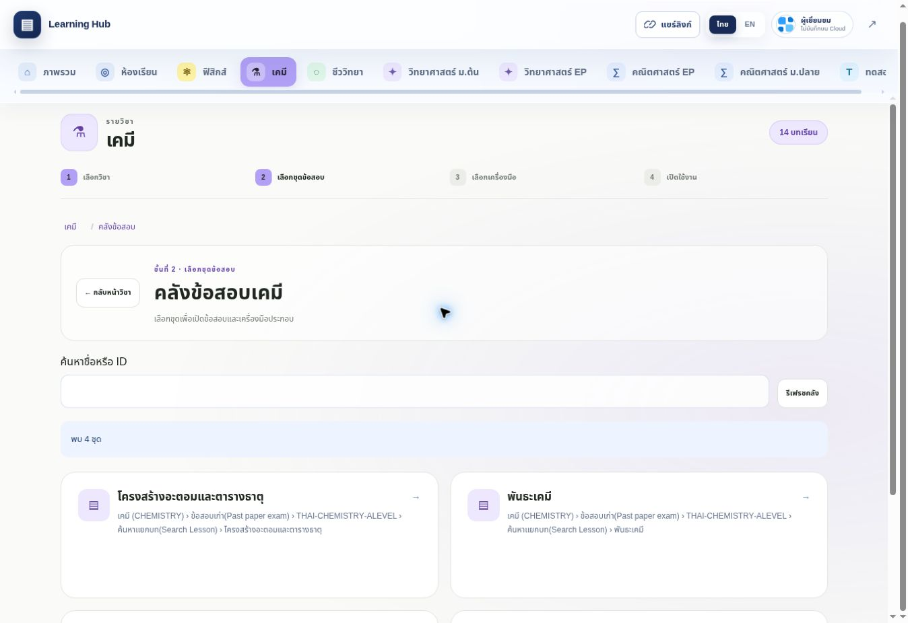
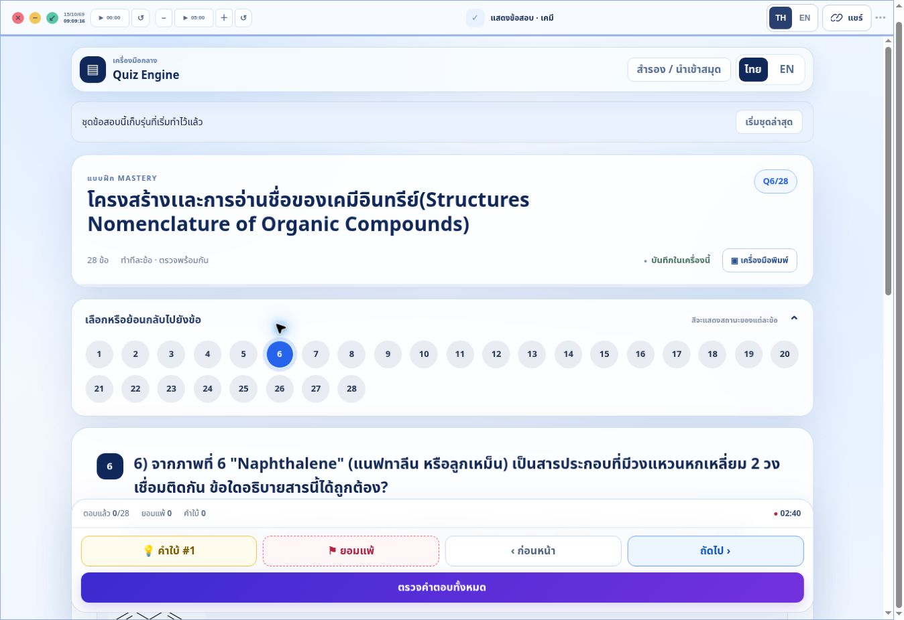
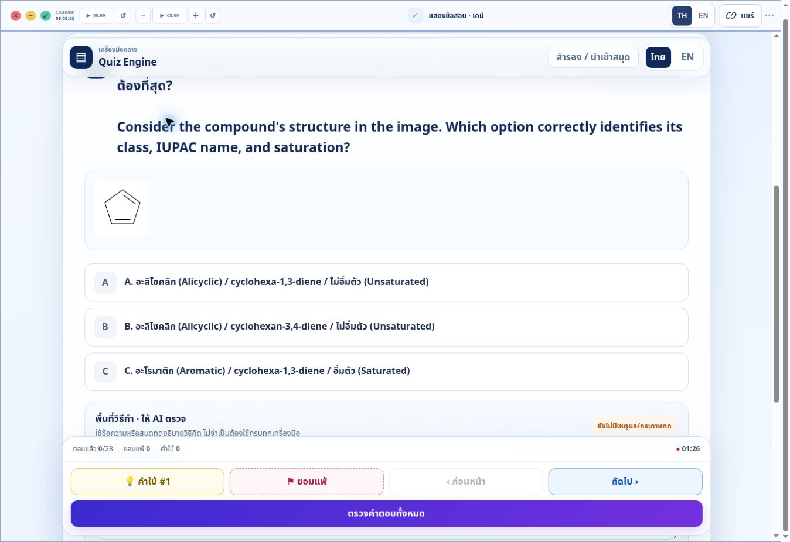

# คลังเคมี — โครงระบบและผลตรวจจริง

ตรวจวันที่ 15 ตุลาคม 2026 (ประเทศไทย) จากโค้ด main ฐาน `c7d5bd8193a655899e94656c09d012ae002bde23`, Google Sheet จริง, ตัวแก้ไข Apps Script ทั้งสองโครงการ และเว็บ GitHub Pages จริง

## 1. ระบบฟิสิกส์ที่ใช้เป็นต้นแบบ

| ส่วน | หน้าที่ / สัญญาที่ต้องรักษา |
| --- | --- |
| Google Sheet `ระบบข้อสอบ ครูนิค` | ใช้ไฟล์เดิม ID `1N3kU1DnP7B5OPkUglCU0KOJcSELWtPJokHxx_j7tDkU` |
| `Sitemap` | A–G เป็นลำดับเมนู, H เป็น QuizID, I เป็นชื่อแท็บ, L เป็น StudentID, M เป็นสถานะ |
| `PHYSIC` / `CHEMISTRY` | A = QuizID(1), B = QuizID(2), C = HTML_Content; จับ ID เต็มหลัง trim แบบ A OR B; แถวที่ทั้งสองช่องตรงกันคืนครั้งเดียว |
| เว็บข้อสอบ Apps Script เดิม | โครงการ `1ovCXWxrjPIHCiLu3g8hhA5zpa_4w_Kxj6GiaEYZ7edml3iDYsjKyXmU_`; `getQuizContent` อ่านข้อมูลตามสัญญาด้านบน ส่วนบัญชีและคะแนนเป็นของเว็บเดิม |
| บริการสำหรับ Hub | โครงการ `1bL3blB5YJoVUPSJev6Yoh5qshDgq3Vg5WURzHqAe7ydfwre5u_GAFef1`; ต้นฉบับ `services/question-bank/Code.gs` และ `appsscript.json`; อ่าน Sheet ผ่าน Advanced Sheets Service v4 แบบ readonly |
| endpoint | ใช้ `/exec` เดิมใน `public/shared/question-bank-config.js`; `action=catalog&subject=physics` หรือ `chemistry`; โหลดข้อด้วย `action=questions&subject=...&key=...` |
| เงื่อนไขเผยแพร่ | ต้องเปิดวิชาใน Script Properties และแถว Sitemap ต้องมี StudentID ว่าง/ALL กับ Status ว่าง/เปิดปกติ; ถ้า ID ซ้ำมีสิทธิ์ขัดกันปิดทั้ง ID |
| หน้าคลัง | `subject-page.js` + `subject-bank-nav.js`; ค้นชื่อ/ID → ชุดข้อสอบ → Quiz/Notebook → Workspace; ใช้ CSS และเครื่องมือกลางเดิม |
| รหัส / รุ่นโจทย์ | `bankKey` สร้างจากวิชา + legacy ID; contentId เป็น `bank-<subject>-<bankKey>`; ข้อเรียง `-001`, `-002`; ฉบับโจทย์มี SHA-256 revision และเก็บใน Drive ส่วนตัวของบริการ |
| ความคืบหน้า | Guest อยู่ในเครื่อง; บัญชีใช้ `quizProgress/{uid}/{contentId}` ของ Hub; เปิดฉบับเก่าตาม revision ที่เซฟ ไม่เอาคำตอบไปจับคู่โจทย์รุ่นใหม่เอง |

การเพิ่มหรือแก้โจทย์ใน Sheet ยังเป็นวิธีทำงานเดิม ไม่ต้องสร้างไฟล์ HTML แยกรายข้อใน GitHub และไม่ต้อง Push ทุกครั้งที่เพิ่มโจทย์ อย่าเปลี่ยนชื่อที่สูตรนำไปสร้าง QuizID โดยไม่วางแผนย้ายรหัส เพราะจะกลายเป็นอีกชุด

## 2. สิ่งที่ทำเพื่อเปิดเคมี

โค้ดเว็บและบริการที่เผยแพร่อยู่รองรับ `physics → PHYSIC` และ `chemistry → CHEMISTRY` แล้ว จึงใช้โครงเดิมได้

เปลี่ยนเพียง Script Property ของ **โครงการบริการ Hub**:

```text
HUB_BANK_ENABLED_SUBJECTS
ก่อน: physics
หลัง: physics,chemistry
```

บันทึกผ่านหน้าตั้งค่าแล้ว และเรียก `/exec` จากภายนอกโดยไม่ส่งบัญชี Google ยืนยันผลจริง โค้ดที่เผยแพร่อ่านค่านี้ทุกคำขอ จึงไม่ต้องเปลี่ยน URL หรือ deploy Apps Script รุ่นใหม่

ไม่ได้เปลี่ยนโค้ดเว็บข้อสอบเดิม, Sheet/สูตร/QuizID, endpoint, archive folder, CSS, Firebase Rules หรือย้ายคะแนน/งานค้างของระบบเก่า ข้อความโจทย์และเฉลยมาจาก Sheet ตามเดิม

## 3. เนื้อหาที่เปิดได้ ณ เวลาตรวจ

Sitemap มีแถวเคมี 21 รายการ เงื่อนไขเดิมอนุญาตให้ทั่วไป 4 ชุด และกันออก 17 ID ตามสิทธิ์/สถานะ ไม่ได้เปิดทั้งแท็บให้ข้ามข้อจำกัดเหล่านี้

| ชุด | bankKey | แถว HTML ที่จับคู่ | จำนวนข้อ |
| --- | --- | ---: | ---: |
| โครงสร้างอะตอมและตารางธาตุ | `b-31a0ffd639986bd45593db7b` | 3 | 3 |
| พันธะเคมี | `b-0f5d2e5f824a330e9f75152c` | 2 | 2 |
| ค้นหาเเยกบท (Search Lesson) | `b-f2100cccb75b2f21b5336977` | 0 | 0 |
| โครงสร้างและการอ่านชื่อเคมีอินทรีย์ | `b-deaf3cde34e4ca88f7037153` | 6 | 28 |

รวม 3 ชุดมีโจทย์ 33 ข้อ อีก 1 ชุดยังว่างและปุ่มเปิด Quiz ถูกปิดตามเดิม จำนวนนี้นับข้อในแต่ละชุด ไม่ใช่ทะเบียนข้อกลางที่ตัดข้อซ้ำข้ามหมวด

ฟิสิกส์ยังอ่านได้ 10 ชุด (8 ชุดมีโจทย์ รวม 118 ข้อเมื่อรวมตามชุด) และเปิดชุดหน่วย SI 14 ข้อจาก Hub จริงได้

## 4. การตรวจที่ทำแล้ว

- ตรวจหัวคอลัมน์จริงของ Sitemap, PHYSIC, CHEMISTRY และแถวเคมี A–C ทั้งช่วงข้อมูลที่มีเนื้อหา ผ่าน Google Drive connector แบบอ่านอย่างเดียว
- ตรวจโครงสร้างข้อเลือกตอบของเคมีทั้ง 33 ข้อ: question-step, data-ans, h3, radio options และ URL รูปแบบ HTTPS ไม่มีสื่อฝังที่ adapter ไม่รองรับในชุดสาธารณะเหล่านี้
- catalog ที่ endpoint ส่งตรงกับ ID ที่ Sitemap อนุญาตทุกชุด ทดลองเรียก key ของชุดที่ถูกปิดจาก endpoint สาธารณะแล้วตอบ `set-unavailable`
- โหลด snapshot ทั้ง 3 ชุดจาก endpoint และตรวจ schema/subject/key/revision ด้วย `validateBankSnapshot` ของเว็บจริง ผ่านทั้งหมด ไม่เก็บ HTML โจทย์หรือข้อมูลนักเรียนไว้ใน Git
- Guest บน GitHub Pages: ค้นหา `พันธะ`, เปิดทั้ง 3 ชุด, ย้อนข้อและเปิดข้อสุดท้ายของชุดอินทรีย์ได้ครบ 28 ข้อ
- ชุดพันธะ: ตารางและเลขห้อยแสดงครบ เลือกคำตอบข้อ 1 → ไปข้อ 2 → ปิด → เปิดใหม่ แล้วย้อนข้อ 1 พบคำตอบเดิมถูกเลือกอยู่
- ชุดอะตอม: เปิดครบ 3 ข้อและเลขยกใน electron configuration แสดงได้
- ชุดอินทรีย์: รูป Structure 1–6 โหลดครบ (`naturalWidth > 0`) และสูตร TeX ในข้อ 28 ถูก MathJax จัดรูป
- เมนูพิมพ์ชุดพันธะแสดงรายการ 2 ข้อและปุ่มชุดเปล่า/เฉลย ตรวจเมนูแล้ว ยังไม่ได้สั่งพิมพ์กระดาษจริงในงานนี้
- ชุดว่างยังแสดง `ยังไม่มีข้อสอบที่รองรับ` พร้อมปุ่ม Quiz ที่ disabled; เปิด Notebook กลางได้พร้อมบริบท `bank-chemistry-...-notebook`
- กลับฟิสิกส์หลังเปิดเคมี: พบ 10 ชุดและเปิดชุดหน่วย SI 14 ข้อได้
- เพิ่ม unit tests เรื่องการเปิดวิชา/สิทธิ์/ชุดว่างของเคมี และการแยกโจทย์กับ archive เมื่อ legacy ID ชนกับฟิสิกส์ รวม `pnpm test:bank` ผ่าน 9 ข้อ
- `pnpm test:unit` ผ่าน 262/262; `pnpm build` ผ่าน 0 errors / 19 draft warnings; ตรวจ artifact แล้ว public 323 ไฟล์ตรงต้นฉบับและเส้นทางอยู่ใต้ `/learning-hub/`

## 5. ข้อจำกัดและงานต่อ

- พบจุดตรวจเนื้อหาเดิมในชุดอินทรีย์ข้อ 1: รูป `Structure 1` ที่โหลดจริงมีลักษณะเป็นวงแหวน 5 เหลี่ยม แต่ตัวเลือกชื่อเป็น `cyclohexa…` ควรเทียบต้นฉบับว่าต้องแก้รูปหรือตัวเลือกก่อนใช้ข้อนี้ ไม่ได้เปลี่ยนโจทย์/ภาพ/เฉลยใน Sheet ให้เอง
- ยังไม่ได้ตรวจ iPad Safari, Apple Pencil, การพิมพ์กระดาษจริง, การย้ายเครื่องด้วยบัญชีนักเรียนจริง หรือ Firebase Rules ของบัญชีจริงในงานนี้ ผล Guest ไม่ใช่หลักฐานการเซฟ Cloud
- Notebook ที่เปิดเป็นเครื่องมือแยกยังเป็น Notebook Core รอบ 5A แบบหน้าเดียวชั่วคราวตามระบบเดิม ปิด/รีเฟรชแล้วหาย อย่าใช้แทนสมุดประกอบ Quiz ที่เก็บร่วมกับงาน
- ไม่ได้รัน AI ตรวจวิธีทำ และไม่ได้ตรวจความถูกต้องทางวิชาการของเฉลยทุกข้อ การตรวจครั้งนี้เป็นการเชื่อมระบบและรูปแบบข้อมูล
- การเปิดเคมีเป็นค่าจริงใน Apps Script ไม่ได้อยู่ใน Git เพียงอย่างเดียว ถ้าย้ายบริการต้องตรวจค่า Property และ archive เดิมด้วย ดูคู่มือหลัก `QUESTION-BANK-START-HERE.md`
- หากต้องหยุดเคมีชั่วคราว เปลี่ยน Property กลับเป็น `physics` โดยคง archive และ ID เดิมไว้ การปิดชุด/วิชายังกันการโหลดฉบับเก่าผ่านบริการตามกฎเดิม

## 6. ภาพจากเว็บจริง

หน้าคลังเคมีหลังเปิดวิชา:



Quiz กลางพร้อมชุดอินทรีย์ 28 ข้อ:



ภาพข้อ 1 สำหรับเทียบรูปกับตัวเลือกตามข้อสังเกตด้านบน:


