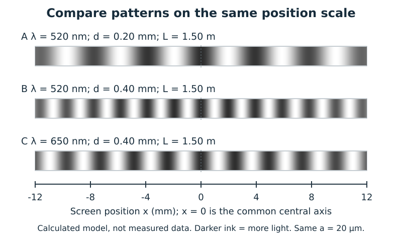
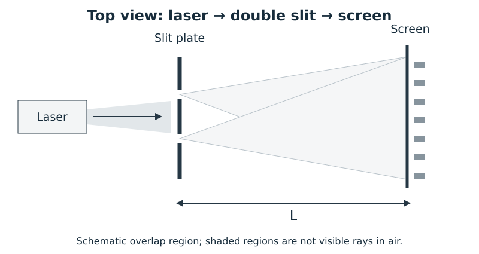
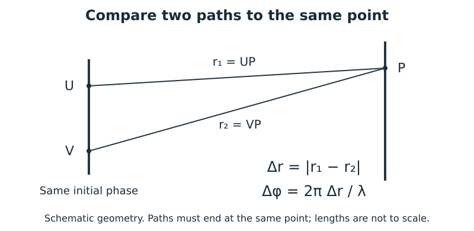
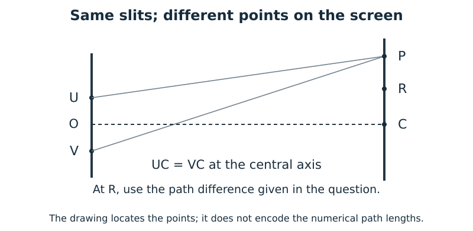
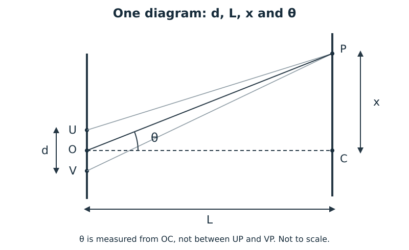
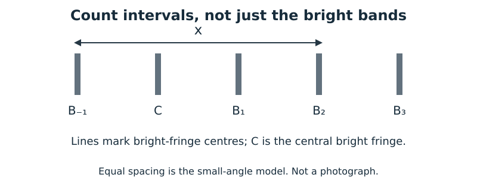
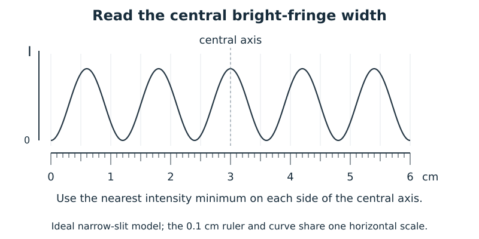
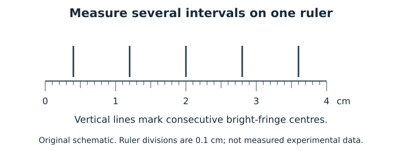
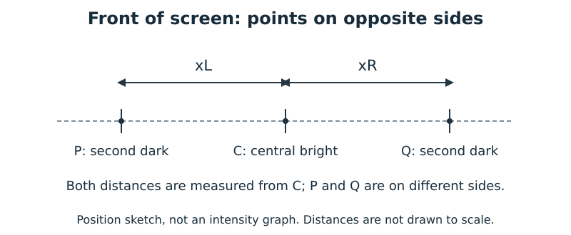

# 10.2 — ร่างโจทย์และภาพทดแทน / Replacement proposal

**ข้อเสนอที่อนุมัติแล้ว 2 พฤศจิกายน 2026 — นำไปปรับใบเรียนรู้ฉบับ 2026-11-02-1 ใน PR #110; ควิซต้นฉบับยังเป็นงานถัดไป**

ร่าง 18 ข้อใหญ่ / 27 ข้อย่อย สองภาษา พร้อม SVG ใหม่ 10 ภาพ ชุดนี้เสนอให้แทนส่วนที่อิงโจทย์เดิม ไม่ใช่เพิ่มทั้งหมดต่อท้ายใบเรียนรู้

## ขอบเขตในร่างก่อนอนุมัติและต้นฉบับที่ต้องเก็บ

- รักษาเส้นเรื่อง เนื้อหา สูตร การพิสูจน์ และคำถามสั้นที่จำเป็นของใบเดิมไว้; ในขั้นร่างยังไม่แก้ไฟล์ที่นักเรียนเปิดอยู่ (นำไปปรับแล้วหลังอนุมัติ ดูสถานะด้านบน)
- เก็บโจทย์/รูป สสวท. ไว้ทำควิซ: ตัวอย่าง 10.1–10.4, ตรวจความเข้าใจ 10.2 ข้อ 1–4, แบบฝึกหัด 10.2 ข้อ 1–3, คำถามท้ายบทข้อ 2, ปัญหาท้ายบท 1–8 และปัญหาท้าทาย 15–20 ตามเลขในหนังสือ
- คู่มือครูแยกนับปัญหาท้าทาย 15–20 ของหนังสือเป็น 1–6; ปัญหาท้าทาย 21 เชื่อมสลิตเดี่ยว จึงเก็บสำหรับหลังเรียน 10.3
- คำถามเดิม 21–25 ใช้ข้อมูลตรงกับปัญหาท้ายบท 1–5 จึงมีข้อ F1–F5 เสนอให้แทนด้วย
- ปัญหาท้ายบท 8: ไฟล์หนังสือใช้ระยะห่างแถบ 10⁻⁷ m แต่คู่มือครูใช้ 10⁻³ m ต้องกำกับฉบับเมื่อสร้างควิซ ไม่ผสมโจทย์กับเฉลยต่างฉบับ; ไม่ได้นำข้อนี้มาใช้เป็นโจทย์ใหม่
- ต้นฉบับ JPEG 15 ไฟล์และใบ/เมนู/ซิมเดิมมี SHA-256 ใน protected-originals.json เป็นภาพสถานะก่อนปรับ; JPEG และซิมยังต้องเหมือนเดิม ส่วนใบ/เมนูเปลี่ยนตามงานที่อนุมัติ

แหล่งต้นฉบับที่ตรวจในรอบก่อน: [หนังสือ ม.5 เล่ม 3](https://drive.google.com/file/d/1R-jSSONIMji5S-_KRSww1Pl7r_QK3Zpj/view) หน้า 109–126,150–155 และ [คู่มือครู](https://drive.google.com/file/d/1CJ9lV_SpjmvXTmZno8Sgg5vx4YotXQzE/view) ส่วนคำตอบ 10.2 และท้ายบท ไฟล์ PDF ไม่ได้รวมในข้อเสนอนี้

## แผนเปลี่ยนภาพ

| ภาพตัดเดิม | ภาพใหม่ที่เสนอ |
| --- | --- |
| intro-single-slit / intro-double-slit | 01-openings; ไม่อ้างว่าเป็นรูปแผ่นจริง |
| experiment-setup | 02-apparatus |
| result-green-d50 / result-green-d100 / result-red-d100 | 03-controlled-patterns; ข้อมูลใหม่ สเกลร่วม ตัวแปรควบคุมชัด |
| fringe-width / exercise-q3 | 08-width-ruler; กราฟแบบจำลองกับไม้บรรทัดใหม่ |
| paths-and-orders | 04-paths-phase และเนื้อหาลำดับแถบเดิม |
| geometry-angle-position / exercise-q1 | 05-geometry |
| understanding-q3 / understanding-q4 | 06-observation-points |
| exercise-q2 | 07-count-intervals |
| further-fringe-ruler | 09-spacing-ruler |

SVG ที่จัดทำเองในใบเดิม slit-types.svg และ wavefronts.svg ยังใช้ได้ ไม่ใช่ภาพตัด แต่จะตรวจความซ้ำก่อนรวมฉบับจริง

## ภาพจริงที่หาไว้เป็นตัวเลือก

[Young’s slits — Graham Beards, Wikimedia Commons](https://commons.wikimedia.org/wiki/File:Young%27s_slits.jpg), [CC BY-SA 4.0](https://creativecommons.org/licenses/by-sa/4.0/). เป็นภาพจากแหล่งอื่น ไม่ใช่ภาพ สสวท. เสนอไว้ให้สังเกตลวดลายเท่านั้น ไม่มีไม้บรรทัดจึงไม่ใช้แทนภาพสำหรับคำนวณ และไม่สมมติค่า L หรือ λ ให้ภาพนี้

ดูภาพหลัก: [มุมและระยะ](05-geometry-preview.png) · [โจทย์อ่านความกว้าง](08-width-ruler-preview.png)

## ร่างภาษาไทย

ทุกโจทย์ใช้แสงสีเดียว อาพันธ์ เริ่มต้นเฟสตรงกันในตัวกลางเดียวกัน และแอมพลิจูดเท่ากันเมื่อกล่าวถึงมืดสนิท สมการมุมใช้ฉากไกล ส่วนสมการตำแหน่งใช้มุมเล็กตามที่ระบุ

### X1 · กิจกรรม — ควบคุมตัวแปรและอ่านความถี่ของแถบบนฉาก

อ้างทักษะ: กิจกรรม 10.1: เปรียบเทียบ d และสีแสง

ใช้ภาพแบบจำลอง A–C ซึ่งใช้ระยะฉากและความกว้างแต่ละช่องเท่ากัน ภาพทุกแถวใช้สเกลตำแหน่งเดียวกัน ในภาพนี้เทาเข้มแทนความเข้มแสงมาก

**a.** เทียบ A กับ B: เปลี่ยนตัวแปรใด และภาพใดมีแถบสว่างอยู่ชิดกันกว่า?

**b.** เทียบ B กับ C: ภาพใดมีระยะห่างแถบมากกว่า? อธิบายด้วยความยาวคลื่น โดยไม่อ้างความเข้มของภาพ

แนวคำตอบสำหรับตรวจร่าง

**a.** เพิ่ม d จาก 0.20 เป็น 0.40 mm โดย λ,L,a คงที่ ภาพ B มีระยะห่างแถบประมาณครึ่งหนึ่งของ A

**b.** C มี λ มากกว่า จึงมีระยะห่างแถบมากกว่า เมื่อ d,L คงที่ อัตราส่วนเป็น 650/520 = 1.25

### X2 · กิจกรรม — วัดระยะโดยอ้างแนวกลางเดียวกัน

อ้างทักษะ: กิจกรรม 10.1: ตัวแปรควบคุม

ก่อนบันทึกรูปแต่ละกรณี ผู้ทดลองทำเครื่องหมายตำแหน่งแนวกลางบนฉากให้ตรงกัน

**a.** เหตุใดการจัดแนวนี้จึงช่วยให้เปรียบเทียบภาพได้? การเลื่อนภาพทั้งภาพแปลว่าระยะห่างแถบเปลี่ยนเสมอหรือไม่?

แนวคำตอบสำหรับตรวจร่าง

**a.** ช่วยแยกการเลื่อนทั้งลวดลายออกจากการเปลี่ยนระยะห่างระหว่างแถบ การเลื่อนทั้งภาพอย่างเดียวไม่พิสูจน์ว่าระยะห่างแถบเปลี่ยน

### E1 · ตัวอย่าง — ผลต่างทางเดิน → ความต่างเฟสสะสม → เฟสเทียบรอบ

อ้างทักษะ: แทนตัวอย่าง 10.1

แหล่ง U,V เริ่มต้นเฟสตรงกัน ให้หาผลต่างทางเดิน ความต่างเฟสสะสม และเฟสเทียบรอบในแต่ละกรณี

**a.** λ = 500 nm, UP = 35.20 μm และ VP = 36.45 μm

**b.** UP = 40λ และ VP = 46λ

แนวคำตอบสำหรับตรวจร่าง

**a.** Δr = 1.25 μm = 1250 nm = 2.5λ; Δφ = 5π rad เทียบรอบเหลือ π rad จึงเฟสตรงข้าม

**b.** Δr = 6λ; Δφ = 12π rad = 6 รอบ เทียบรอบเป็น 0 rad จึงเฟสตรงกัน

### E2 · ตัวอย่าง — แยกชนิดแถบและอันดับ

อ้างทักษะ: แทนตัวอย่าง 10.2

ใช้แสง λ = 480 nm จากสองแหล่งที่เริ่มต้นเฟสตรงกัน ระบุชนิดและอันดับแถบที่จุด P

**a.** ผลต่างทางเดิน 1440 nm

**b.** ผลต่างทางเดิน 2160 nm

แนวคำตอบสำหรับตรวจร่าง

**a.** Δr/λ = 3 จึงเป็นแถบสว่างอันดับ 3

**b.** Δr/λ = 4.5 = n−0.5 จึง n = 5 เป็นแถบมืดอันดับ 5

### U1 · คำถาม — หลักฐานจากลวดลาย ไม่ใช้ชื่อบุคคลเป็นคำตอบ

อ้างทักษะ: แทนตรวจความเข้าใจ 10.2 ข้อ 1

มีผู้เสนอว่าเมื่อแสงผ่านสองช่อง ฉากต้องมีเพียงสองบริเวณสว่างที่ตรงกับช่อง

**a.** ลวดลายหลายแถบในภาพขัดกับคำอธิบายนี้ตรงไหน และการเสริม–หักล้างช่วยอธิบายบริเวณมืดได้อย่างไร?

แนวคำตอบสำหรับตรวจร่าง

**a.** เพียงทางเดินตรงสองแนวอธิบายหลายแถบไม่ได้ คลื่นจากสองช่องซ้อนทับกัน บางตำแหน่งเสริมและบางตำแหน่งหักล้าง จึงเกิดสว่าง–มืดสลับกัน

### U2 · คำถาม — อย่าปัดผลต่างทางเดินทุกค่าเป็นสว่างหรือมืด

อ้างทักษะ: แทนตรวจความเข้าใจ 10.2 ข้อ 2

สองแหล่งเริ่มต้นเฟสตรงกัน ให้ UP = 92.50λ และ VP = 96.75λ

**a.** หาผลต่างทางเดินและความต่างเฟสสะสม

**b.** จุดนี้เป็นตำแหน่งสว่างสูงสุดหรือมืดสนิทหรือไม่?

แนวคำตอบสำหรับตรวจร่าง

**a.** Δr = 4.25λ; Δφ = 8.5π rad

**b.** ไม่ใช่ทั้งสอง เพราะ 4.25 ไม่ใช่จำนวนเต็มหรือครึ่งจำนวนคี่ เฟสเทียบรอบเป็น π/2 rad ไม่ปัดเป็น 4 หรือ 4.5

### U4 · คำถาม — ผลต่างทางเดินไม่ใช่จำนวน λ ของทางเดินเดียว

อ้างทักษะ: แทนตรวจความเข้าใจ 10.2 ข้อ 4

สำหรับรูป ให้ UP = (k+2)λ และ VP = (k+6)λ โดย k เป็นจำนวนเต็มไม่ลบ

**a.** ที่ P เป็นแถบใด อันดับเท่าใด? จำเป็นต้องรู้ k หรือไม่?

แนวคำตอบสำหรับตรวจร่าง

**a.** Δr = 4λ จึงเป็นแถบสว่างอันดับ 4 ไม่ต้องรู้ k เพราะหักล้างออกเมื่อลบทางเดิน

### E3 · ตัวอย่าง — ใช้ d sinθ และค่าแบบจำลองที่ไม่ต้องปัดอันดับ

อ้างทักษะ: แทนตัวอย่าง 10.3

แสง λ = 520 nm ผ่านสลิตคู่ d = 13.0 μm ใช้สมการมุมในกรณีฉากไกล พิจารณาจุด P ทีละกรณี โดยให้ค่า sine มาแล้ว

**a.** เมื่อ sinθ = 0.0800 ระบุชนิดและอันดับแถบ

**b.** เมื่อ sinθ = 0.1000 ระบุชนิดและอันดับแถบ

แนวคำตอบสำหรับตรวจร่าง

**a.** d sinθ/λ = 2.00 จึงเป็นแถบสว่างอันดับ 2

**b.** d sinθ/λ = 2.50 จึงเป็นแถบมืดอันดับ 3

### E4 · ตัวอย่าง — ใช้ตำแหน่งบนฉากและตรวจมุมเล็ก

อ้างทักษะ: แทนตัวอย่าง 10.4

แสง λ = 640 nm, d = 0.160 mm และ L = 1.50 m จุด P อยู่ด้านเดียวกับที่รูปแสดง ระบุชนิดและอันดับแถบในแต่ละกรณี พร้อมตรวจ x/L

**a.** x = 18.0 mm

**b.** x = 21.0 mm

แนวคำตอบสำหรับตรวจร่าง

**a.** x/L = 0.0120; dx/(λL) = 3.00 เป็นแถบสว่างอันดับ 3 ใช้มุมเล็กได้

**b.** x/L = 0.0140; dx/(λL) = 3.50 เป็นแถบมืดอันดับ 4

### U3 · คำถาม — อ่านแนวกลาง/ผลต่างทางเดินและเปลี่ยนหลายตัวแปร

อ้างทักษะ: แทนตรวจความเข้าใจ 10.2 ข้อ 3

U,V สมมาตรกับแนวกลาง OC และเริ่มต้นเฟสตรงกัน ที่ R ให้ |UR−VR| = 1.5λ

**a.** ที่ C และ R เป็นแถบใด อันดับเท่าใด?

**b.** ถ้า L ใหม่ = 1.5L และ d ใหม่ = 3d โดย λ คงเดิม ระยะห่างแถบติดกันเป็นกี่เท่าของเดิม?

แนวคำตอบสำหรับตรวจร่าง

**a.** C มีทางเดินเท่ากัน จึงเป็นแถบสว่างกลาง n = 0; R เป็นแถบมืดอันดับ 2

**b.** Δx ใหม่/Δx เดิม = 1.5/3 = 0.5 ระยะห่างลดครึ่งหนึ่ง

### P1 · โจทย์ — ตำแหน่งแถบสว่างอันดับที่ไม่ใช่ 1

อ้างทักษะ: แทนแบบฝึกหัด 10.2 ข้อ 1

แสง λ = 460 nm ผ่านสลิตคู่ d = 0.230 mm ฉากห่าง L = 1.20 m ให้มุมเล็ก

**a.** หาตำแหน่งแถบสว่างอันดับ 2 วัดจากแนวกลาง เป็น mm

แนวคำตอบสำหรับตรวจร่าง

**a.** x₂ = 2λL/d = 4.80×10⁻³ m = 4.80 mm

### P2 · โจทย์ — อ่านหลายช่วงแล้วเชื่อมการเปลี่ยน L และความเข้ม

อ้างทักษะ: แทนแบบฝึกหัด 10.2 ข้อ 2

ใช้ λ = 540 nm, d = 0.180 mm และ L = 1.60 m ให้มุมเล็ก เส้นในรูปแทนศูนย์กลางแถบสว่าง โดย C เป็นแถบกลาง ทุกข้อย่อยเทียบกับสภาพเริ่มต้นนี้

**a.** หาระยะ x ที่กำกับในรูป เป็น mm ระวังจำนวนช่วง

**b.** ถ้าเลื่อนฉากไปที่ L = 2.40 m โดยแสงและสลิตเดิม x ใหม่เป็นเท่าใด?

**c.** ถ้าเพิ่มความเข้มแสงที่ตกสลิต แต่คง λ,d,L เดิม x เปลี่ยนหรือไม่?

แนวคำตอบสำหรับตรวจร่าง

**a.** มี 3 ช่วง; Δx = λL/d = 4.80 mm จึง x = 14.4 mm

**b.** x แปรตาม L จึง x ใหม่ = 14.4(2.40/1.60) = 21.6 mm

**c.** x ไม่เปลี่ยน เพราะตำแหน่งแถบตามแบบจำลองนี้ขึ้นกับ λ,d,L ไม่ใช่ความเข้มแสง

### P3 · โจทย์ — วัดความกว้างหนึ่งแถบจากตำแหน่งมืดที่ขนาบ

อ้างทักษะ: แทนแบบฝึกหัด 10.2 ข้อ 3

กราฟเป็นแบบจำลองความเข้มแสง โดยแนวกลางอยู่ที่ขีด 3.0 cm บนไม้บรรทัด ไม่ใช่รูปผลทดลองจริง

**a.** อ่านตำแหน่งความเข้มต่ำสุดที่ใกล้แนวกลางที่สุดทั้งสองข้าง แล้วหาความกว้างแถบสว่างกลาง

แนวคำตอบสำหรับตรวจร่าง

**a.** อ่านได้ประมาณ 2.4 และ 3.6 cm ความกว้าง = 3.6−2.4 = 1.2 cm วัดแถบเดียว ไม่คร่อมกลุ่มแถบทั้งหมด

### F1 · โจทย์ — เปลี่ยนจากสว่างแรกเป็นมืดแรก

อ้างทักษะ: แทนคำถามเดิม 21 / ท้ายบทปัญหา 1

ใช้แสง λ = 620 nm, d = 0.310 mm และ L = 1.80 m ให้มุมเล็ก

**a.** แถบมืดอันดับ 1 อยู่ห่างจากแนวกลางเท่าใด เป็น mm?

แนวคำตอบสำหรับตรวจร่าง

**a.** x = (1−0.5)λL/d = 1.80 mm

### F2 · โจทย์ — อ่านหลายช่วงจากไม้บรรทัดใหม่

อ้างทักษะ: แทนคำถามเดิม 22 / ท้ายบทปัญหา 2

เส้นตั้งทั้งห้าแทนศูนย์กลางแถบสว่างที่ติดกัน

**a.** หาระยะห่างแถบสว่างติดกัน โดยวัดตั้งแต่เส้นแรกถึงเส้นที่ห้าแล้วหารจำนวนช่วง ตอบเป็น cm

แนวคำตอบสำหรับตรวจร่าง

**a.** เส้นแรก 0.4 cm เส้นที่ห้า 3.6 cm ช่วงรวม 3.2 cm มี 4 ช่วง จึง Δx = 0.80 cm

### F3 · โจทย์ — หาความยาวคลื่นจากอันดับและตำแหน่งใหม่

อ้างทักษะ: แทนคำถามเดิม 23 / ท้ายบทปัญหา 3

สลิตคู่ห่าง 0.240 mm ฉากห่าง 1.50 m แถบสว่างอันดับ 5 อยู่ห่างแนวกลาง 17.5 mm ให้มุมเล็ก

**a.** แสงมีความยาวคลื่นเท่าใด เป็น nm?

แนวคำตอบสำหรับตรวจร่าง

**a.** λ = dx/(5L) = 5.60×10⁻⁷ m = 560 nm

### F4 · โจทย์ — ระยะคร่อมสองด้านแทนระยะติดกัน

อ้างทักษะ: แทนคำถามเดิม 24 / ท้ายบทปัญหา 4

ใช้แสง λ = 450 nm, d = 0.300 mm และ L = 1.60 m ให้มุมเล็ก ในรูป P,Q เป็นแถบมืดอันดับ 2 คนละด้านของ C

**a.** ระยะจากแถบมืดอันดับ 2 ทางซ้ายถึงแถบมืดอันดับ 2 ทางขวาเป็นเท่าใด? ระบุว่าต้องบวกหรือลบระยะจากแนวกลาง

แนวคำตอบสำหรับตรวจร่าง

**a.** Δx = 2.40 mm แต่ละด้านห่างกลาง 1.5Δx = 3.60 mm จึงคร่อมสองด้าน 7.20 mm

### F5 · โจทย์ — จัดรูปหาระยะห่างสลิตด้วยข้อมูลใหม่

อ้างทักษะ: แทนคำถามเดิม 25 / ท้ายบทปัญหา 5

ต้องการให้แถบสว่างติดกันห่าง 3.60 mm เมื่อใช้แสง λ = 480 nm และวางฉากห่าง 1.50 m ให้มุมเล็ก

**a.** ต้องใช้สลิตคู่ห่างกันเท่าใด เป็น μm?

แนวคำตอบสำหรับตรวจร่าง

**a.** d = λL/Δx = 2.00×10⁻⁴ m = 200 μm

## English draft

**Approved proposal: these items are integrated into worksheet revision 2026-11-02-1 in PR #110. They replace source-derived tasks; the original crops and Quiz remain unchanged.**

All tasks use monochromatic coherent sources, initially in phase in one medium, with equal amplitudes when complete darkness is claimed. Angular relations assume far field; screen-position relations use small angles where stated.

### X1 · experiment

Use model strips A–C. Screen distance and individual slit width are fixed, and every strip uses the same position scale. Darker ink represents greater light intensity.

**a.** Compare A and B: which variable changes, and which pattern has closer bright fringes?

**b.** Compare B and C: which has greater fringe spacing? Explain using wavelength, not brightness.

Draft review answer

**a.** d increases from 0.20 to 0.40 mm with λ,L,a fixed. B has approximately half A’s fringe spacing.

**b.** C has the longer wavelength and therefore greater spacing with d,L fixed. The ratio is 650/520 = 1.25.

### X2 · experiment

Before recording each case, the experimenter aligns the central axis with the same screen mark.

**a.** Why does this help comparison? Must shifting the whole pattern mean that fringe spacing has changed?

Draft review answer

**a.** It separates a translation of the whole pattern from a change in spacing. Translation alone does not establish a spacing change.

### E1 · worked-example

Sources U,V start in phase. In each case find the path difference, accumulated phase difference and equivalent phase modulo 2π.

**a.** λ = 500 nm, UP = 35.20 μm and VP = 36.45 μm

**b.** UP = 40λ and VP = 46λ

Draft review answer

**a.** Δr = 1.25 μm = 1250 nm = 2.5λ; Δφ = 5π rad, equivalent to π rad: opposite phase.

**b.** Δr = 6λ; Δφ = 12π rad = six cycles, equivalent to 0 rad: in phase.

### E2 · worked-example

Use λ = 480 nm from two initially in-phase sources. Identify the fringe type and order at P.

**a.** Path difference 1440 nm

**b.** Path difference 2160 nm

Draft review answer

**a.** Δr/λ = 3, so it is the third bright fringe.

**b.** Δr/λ = 4.5 = n−0.5, so n = 5: the fifth dark fringe.

### U1 · short-question

Someone claims that two openings must produce only two bright regions aligned with them.

**a.** How do the multiple bands challenge this account, and how does interference explain dark regions?

Draft review answer

**a.** Two straight transmission paths alone do not explain many fringes. Waves from both openings overlap; constructive and destructive interference produce alternating bright and dark regions.

### U2 · short-question

Two sources start in phase. Let UP = 92.50λ and VP = 96.75λ.

**a.** Find the path difference and accumulated phase difference.

**b.** Is this an intensity maximum or a complete minimum?

Draft review answer

**a.** Δr = 4.25λ; Δφ = 8.5π rad.

**b.** Neither: 4.25 is neither an integer nor a half-integer. The equivalent phase is π/2 rad; do not round it to 4 or 4.5.

### U4 · short-question

For the diagram, let UP = (k+2)λ and VP = (k+6)λ, where k is a nonnegative integer.

**a.** What fringe type and order occur at P? Must k be known?

Draft review answer

**a.** Δr = 4λ gives the fourth bright fringe. k cancels when the paths are subtracted, so its value is unnecessary.

### E3 · worked-example

Light of λ = 520 nm passes through slits separated by d = 13.0 μm. Use the far-field angular relation for point P in each separate case; sine values are supplied.

**a.** For sinθ = 0.0800, identify the fringe type and order.

**b.** For sinθ = 0.1000, identify the fringe type and order.

Draft review answer

**a.** d sinθ/λ = 2.00, so it is the second bright fringe.

**b.** d sinθ/λ = 2.50, so it is the third dark fringe.

### E4 · worked-example

For λ = 640 nm, d = 0.160 mm and L = 1.50 m, point P is on the side shown. Identify the fringe type/order in each case and check x/L.

**a.** x = 18.0 mm

**b.** x = 21.0 mm

Draft review answer

**a.** x/L = 0.0120; dx/(λL) = 3.00: the third bright fringe. The small-angle approximation is suitable.

**b.** x/L = 0.0140; dx/(λL) = 3.50: the fourth dark fringe.

### U3 · short-question

U,V are symmetric about central axis OC and start in phase. At R, |UR−VR| = 1.5λ.

**a.** What fringe type and order occur at C and R?

**b.** If the new L is 1.5L and the new d is 3d, with λ fixed, what fraction of the original adjacent-fringe spacing results?

Draft review answer

**a.** C has equal paths: central bright fringe, n = 0. R is the second dark fringe.

**b.** New/old Δx = 1.5/3 = 0.5: the spacing is halved.

### P1 · practice

Light of λ = 460 nm passes through slits separated by d = 0.230 mm onto a screen L = 1.20 m away. Assume small angles.

**a.** Find the second bright-fringe position measured from the central axis, in mm.

Draft review answer

**a.** x₂ = 2λL/d = 4.80×10⁻³ m = 4.80 mm.

### P2 · practice

Use λ = 540 nm, d = 0.180 mm and L = 1.60 m at small angles. Lines mark bright-fringe centres; C is central. Every subpart refers to this original setup.

**a.** Find the marked x in mm, taking care to count intervals.

**b.** Move the screen to L = 2.40 m with the same light and slits. What is the new x?

**c.** If incident intensity increases but the original λ,d,L remain fixed, does x change?

Draft review answer

**a.** There are three intervals. Δx = λL/d = 4.80 mm, so x = 14.4 mm.

**b.** x is proportional to L, so new x = 14.4(2.40/1.60) = 21.6 mm.

**c.** x is unchanged: fringe positions in this model depend on λ,d,L, not incident intensity.

### P3 · practice

The graph models light intensity, with the central axis at the ruler’s 3.0 cm mark. It is not an experimental photograph.

**a.** Read the nearest intensity minimum on each side of the central axis, then find the central bright-fringe width.

Draft review answer

**a.** The bounds read approximately 2.4 and 3.6 cm. Width = 3.6−2.4 = 1.2 cm, for one band rather than the entire pattern.

### F1 · practice

Use λ = 620 nm, d = 0.310 mm and L = 1.80 m at small angles.

**a.** How far is the first dark fringe from the central axis, in mm?

Draft review answer

**a.** x = (1−0.5)λL/d = 1.80 mm.

### F2 · practice

The five vertical lines mark consecutive bright-fringe centres.

**a.** Find adjacent bright-fringe spacing by measuring from the first to fifth line and dividing by the number of intervals. Give cm.

Draft review answer

**a.** First line: 0.4 cm; fifth: 3.6 cm. The 3.2 cm span has four intervals, so Δx = 0.80 cm.

### F3 · practice

Slits are 0.240 mm apart, the screen is 1.50 m away, and the fifth bright fringe lies 17.5 mm from the central axis. Assume small angles.

**a.** Find the wavelength in nm.

Draft review answer

**a.** λ = dx/(5L) = 5.60×10⁻⁷ m = 560 nm.

### F4 · practice

Use λ = 450 nm, d = 0.300 mm and L = 1.60 m at small angles. P and Q mark second dark fringes on opposite sides of C.

**a.** Find the distance from the second dark fringe on the left to the second dark fringe on the right. State whether the distances from the centre should be added or subtracted.

Draft review answer

**a.** Δx = 2.40 mm. Each side is 1.5Δx = 3.60 mm from centre, so the two-sided distance is 7.20 mm.

### F5 · practice

To obtain 3.60 mm adjacent bright-fringe spacing, use λ = 480 nm and a screen 1.50 m away. Assume small angles.

**a.** What slit separation is needed, in μm?

Draft review answer

**a.** d = λL/Δx = 2.00×10⁻⁴ m = 200 μm.

## Primary factual/image checks

- [OpenStax University Physics 3, 3.1](https://openstax.org/books/university-physics-volume-3/pages/3-1-youngs-double-slit-interference): coherent sources, interference and path conditions. Used to check principles; no example/problem text or image copied.
- [OpenStax University Physics 3, 3.2](https://openstax.org/books/university-physics-volume-3/pages/3-2-mathematics-of-interference): angle and small-angle relations. New values and tasks are authored independently.
- [Wikimedia Commons image page](https://commons.wikimedia.org/wiki/File:Young%27s_slits.jpg): creator/license verified for the optional photograph. Image is linked as a candidate only.

## QA / readiness

- Independent arithmetic: 25 numeric cases passed, covering the new phases/orders, small-angle positions, multi-interval spans, two-sided distances and inverse calculations. Ideal ruler minima/spacing models checked separately.
- All 18 groups / 27 subparts have full TH/EN prompts and answers; README text matches proposal.json. Every local image link resolves.
- All 10 SVGs rendered with Inkscape and were visually inspected. Text bounding boxes lie inside the final viewBoxes. Fixes included moving the d label clear, matching single/double opening widths, a forward-only propagation arrow, and more space below L.
- Geometry audit reversed U2 path-length ordering to agree with the drawn point above the central axis; its phase result is unchanged. F4 has a separate two-sided screen sketch rather than the one-sided geometry.
- Protected hashes pass for all 15 original JPEG crops plus the production sheet, bank menu and lab. No existing content or source image changed.
- Production build passed and verified 694 public files. No shared engine/config/dependency/Rules change. No unrelated runtime test suite was rerun for unused proposal assets.
- Limits: this is a preparation draft. No integration, browser/iPad or central-print/PDF test is claimed. The two preview PNGs are renders of the new editable SVGs.
- External photograph: the creator and CC BY-SA 4.0 license were checked on its Commons page; it is only a linked candidate. Its binary was not materialized for local QA and it has not been integrated. New worksheet drawings are all authored SVGs.

## Integration follow-up — 2026-11-02

The teacher approved implementation. The same sheet/content/bank identity now
uses these replacements and the new diagrams; source JPEGs remain intact.
Question numbering is 1–37, examples 1–4, with 50 separately spaced question rows
and 14 headed note areas per language (64 slots total). All 14 notes remain;
three adjust diagram-specific wording, and the phase derivation is preserved.
Original source-derived fragments/contexts are archived under
`docs/quiz/preparation/physics-double-slit-10-2/` rather than left in the student
sheet. The guide has eight authored steps tied to actual targets. The original
protected-originals.json is a historical pre-edit snapshot; the worksheet and its menu description
hashes are expected to change in this approved follow-up.

Browser/print verification is recorded in PHYSICS-DOUBLE-SLIT-10-2-QA.md after the
final check. The earlier proposal-only limits describe that earlier checkpoint.
